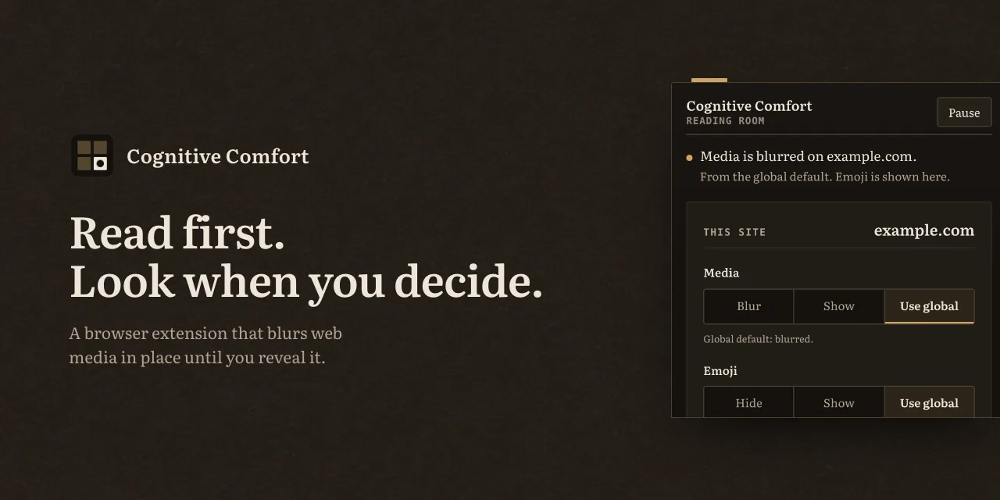
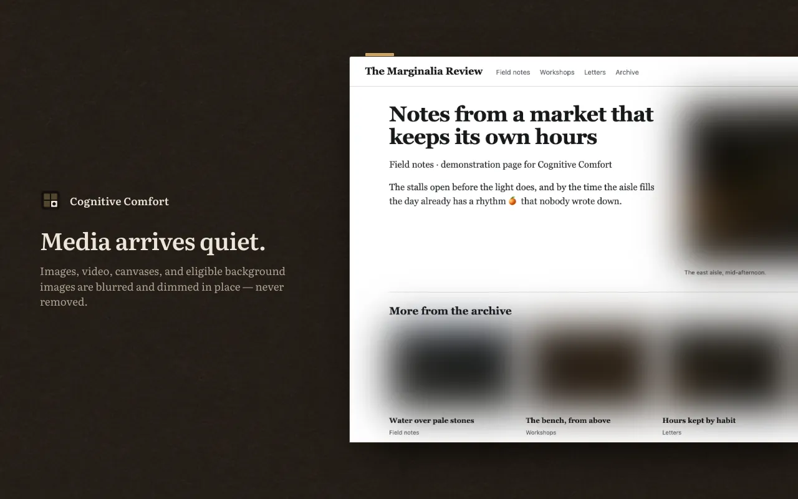
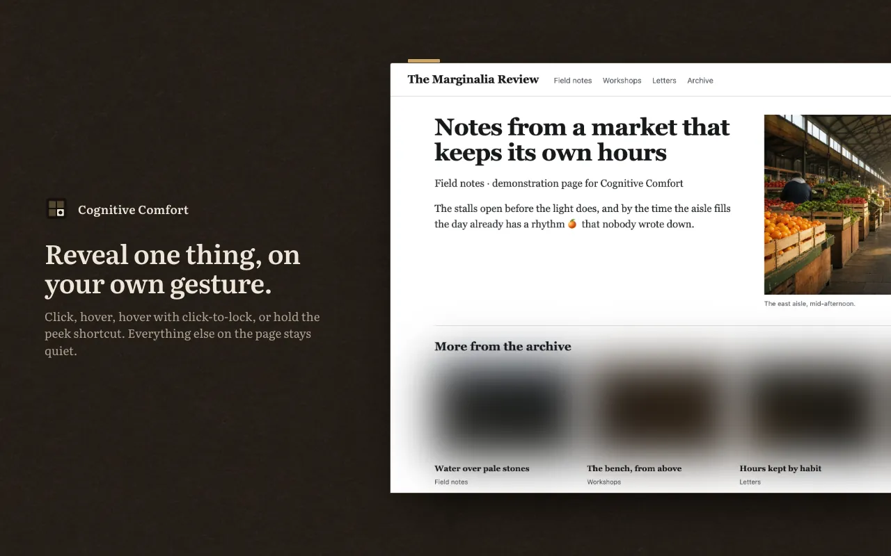
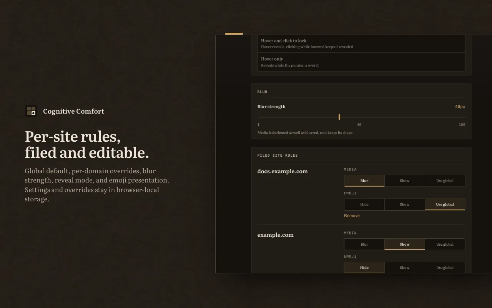

# Cognitive Comfort

Cognitive Comfort blurs images, video, and other media on the pages you visit until you
choose to see them. Nothing is removed. Media keeps its place and its size behind a CSS
filter, and a hover, a click, or a held shortcut brings it back. Built with WXT for
Chrome, Edge, Firefox, and macOS Safari.

**Install** ·
[Firefox](https://addons.mozilla.org/firefox/addon/cognitive-comfort/) ·
[Chrome](https://chromewebstore.google.com/detail/cognitive-comfort/fachhhdjmbceikclmlicjdaikhajdpbi) ·
[Edge](https://chromewebstore.google.com/detail/cognitive-comfort/fachhhdjmbceikclmlicjdaikhajdpbi) ·
[Safari](https://apps.apple.com/app/cognitive-comfort/id6805033108?mt=12)

**Watch** · [one-minute demonstration](https://www.youtube.com/watch?v=fn-R53QhF-M)

## What it does

- Blurs images, video, canvas, supported embedded media, and eligible CSS background images.
- Reveals media by hover, by click, or by hover with click to lock. You pick the gesture.
- Shows everything while you hold the peek shortcut (`Ctrl+Shift+A`).
- Keeps a global default plus rules per domain for media and emoji, with visible precedence.
- Hides emoji presentation if you switch it on.

| | |
| --- | --- |
|  |  |



The content script reads the page to do this: DOM elements, computed styles, geometry, and text nodes. Emoji hiding wraps matching emoji text in local `<span>` elements and restores the visible text when you switch it off. The extension stores settings and domain overrides, nothing else. It does not transmit page data, run analytics, load third-party code, or make network requests of its own. See [`PRIVACY.md`](./PRIVACY.md).

## Repository and build profiles

`main` is the reviewable development and release branch.

`config/profiles/*.toml` provide product identity and defaults:

- `public`: release behavior, so all-media scope, hover with click lock reveal, 50px blur, emoji blocking disabled.
- `local`: the same media defaults with emoji blocking enabled and a local Safari bundle identity.

Machine paths, deployment, Apple teams, signing, store credentials, and submission live outside this repository.

## Build from source

Prerequisites: Node.js 20+, pnpm 11.13.1, and optionally `just`. The E2E suite also requires Playwright's Chromium and WebKit binaries.

```fish
git clone https://github.com/olegpulatov/cognitive-comfort.git
cd cognitive-comfort
pnpm install --frozen-lockfile
pnpm exec playwright install chromium webkit
env BUILD_PROFILE=public just build-all
```

Unpacked outputs:

- Chrome: `.output/chrome-mv3`
- Edge: `.output/edge-mv3`
- Firefox 140+: `.output/firefox-mv2`

Package and validate release artifacts:

```fish
env BUILD_PROFILE=public just zip-all
just validate-release chrome
just validate-release edge
just validate-release firefox
```

Versioned packages follow these names:

- `.output/cognitive-comfort-<version>-chrome.zip`
- `.output/cognitive-comfort-<version>-edge.zip`
- `.output/cognitive-comfort-<version>-firefox.zip`
- `.output/cognitive-comfort-<version>-sources.zip`

The Firefox sources ZIP is generated from an explicit source allowlist.

## Common commands

| Task                             | Command                                        |
| -------------------------------- | ---------------------------------------------- |
| Dev session                      | `just dev chrome`                              |
| Type-check                       | `just compile`                                 |
| Unit tests                       | `just test`                                    |
| Coverage gate                    | `just test-coverage`                           |
| Chromium extension smoke         | `just test-e2e`                                |
| Build one target                 | `env BUILD_PROFILE=public just build chrome`   |
| Zip all targets                  | `env BUILD_PROFILE=public just zip-all`        |
| Generate unsigned Safari project | `env BUILD_PROFILE=public just safari-project` |
| Verify then tag locally          | `just tag patch`                               |

Tagging requires `main`, verifies first, stages only `package.json`, and does not push or publish.

## Testing

- `just test` runs deterministic unit and DOM behavior tests.
- `just test-coverage` enforces 75% statements, lines, and functions plus 65% branches over core utilities and content behavior.
- `just test-e2e` builds the public Chrome artifact, loads it in Playwright Chromium, and runs complementary WebKit engine regressions.
- [`docs/browser-testing.md`](./docs/browser-testing.md) defines required stable Chrome, Edge, Firefox, and Safari checks.

Playwright covers Chromium extension behavior plus WebKit rendering regressions. Real Edge, Firefox, and Safari extension smoke remains manual because Playwright does not load the Firefox or Safari extension artifacts.

## Persistence

Settings use one `browser.storage.local` key, `comfortSettings`. Stored values are merged over profile defaults, validated, and versioned with `schemaVersion`. Per-domain maps are updated through the background write queue so concurrent changes survive.

## Keyboard shortcuts

| Shortcut       | Action              |
| -------------- | ------------------- |
| `Ctrl+Shift+U` | Pause or resume     |
| `Ctrl+Shift+O` | Toggle current site |
| `Ctrl+Shift+A` | Peek while held     |
| `Ctrl+Shift+E` | Toggle global media |

On macOS these use Control, not Command. The popup's Edit button links to browser shortcut settings.

## Safari project generation

Full Xcode is required for `safari-web-extension-converter`:

```fish
env BUILD_PROFILE=public just safari-project
```

This creates an unsigned project under `safari/`. Public tooling does not inspect certificates, select an Apple team, run a signed archive, install an app, or update `/Applications`.

## License and branding

Source code is available under the Mozilla Public License 2.0; see [`LICENSE`](./LICENSE). The Cognitive Comfort name and reserved artwork are not licensed for fork branding. Forks must rename the product and replace reserved artwork as described in [`TRADEMARKS.md`](./TRADEMARKS.md).

## Contributing and security

See [`CONTRIBUTING.md`](./CONTRIBUTING.md) for behavioral evidence requirements. Report vulnerabilities through GitHub private vulnerability reporting as described in [`SECURITY.md`](./SECURITY.md).
